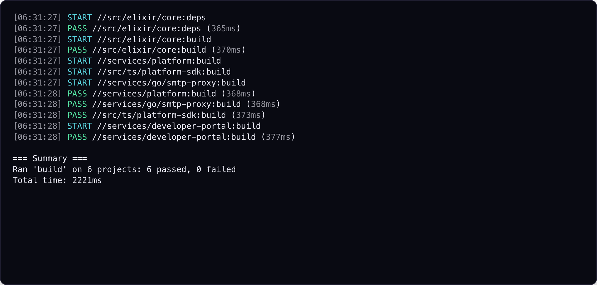
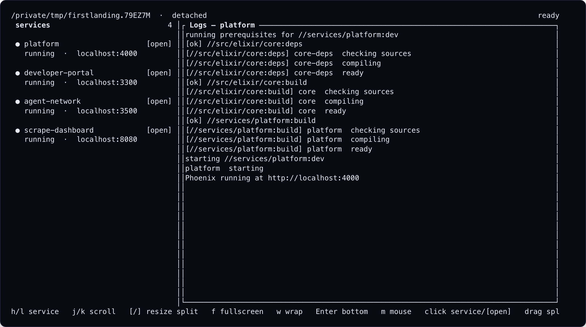

# Aster

[](https://github.com/ArchAstro/aster/actions/workflows/ci.yml)
[](https://github.com/ArchAstro/aster/releases/latest)
[](LICENSE)
[](Cargo.toml)


Aster is a build orchestrator for polyglot monorepos. It discovers projects
across languages, connects their dependencies into one graph, and runs work in
the correct order while independent targets execute in parallel.

```console
aster test --all
aster build //services/api
aster affected test --base=main
```

### Go tests with shell setup

When setup exports build flags or starts fixtures with an EXIT cleanup trap,
use the explicit external-Go boundary:

```toml
[targets.test]
command = "bash -ec 'source setup.sh; aster exec-go-test -- -count=1 ./...'"
```

`affected --related` records a deferred selection in the dry-run command; it
never executes setup during planning. At runtime the owning shell performs
setup, then Aster checks buildability with `go list` and runs external `go test`
in that shell's exported environment and current directory. The shell waits
and retains its cleanup trap. Do not use `exec` if the shell must run an EXIT
trap. This boundary deliberately bypasses shell functions and aliases named
`go`; unmarked shell commands retain their existing behavior and conservative
full-suite fallback. Without a related selection the helper runs the supplied
Go test arguments unchanged. Unknown buildability falls back to the full
invocation, and failure to start Go remains an error. Deferred rewriting requires
static arguments and a resolvable running Aster executable. Shell-active argument
forms (including variables and package globs) retain the original command rather
than being converted to literal arguments. Ordinary Aster commands do not expand
shell syntax; expansion requires an explicit shell such as `bash -ec` above.

New to Aster? Follow the [end-to-end getting started tutorial](GETTING_STARTED.MD)
to create a workspace, connect project dependencies, build, test, cache, watch,
and run only affected projects.

[Install](#installation) · [Quick start](#quick-start) ·
[Configuration](#project-configuration) · [Contributing](CONTRIBUTING.md) ·
[Support](SUPPORT.md) · [Security](SECURITY.md)

## Why Aster

- **One graph across languages.** Rust, Node.js, Go, Python, Elixir, Java,
  Kotlin, and Ruby projects can depend on one another while each ecosystem
  keeps using its native tools.
- **Correct work, maximum concurrency.** Prerequisites run first; unrelated
  targets run together; failures stop the work that depends on them.
- **Fast local feedback.** Content-aware caching, affected-project selection,
  and watch mode avoid repeating work that cannot change the result.
- **A single development cockpit.** `aster services up` supervises long-lived
  services with focused logs, restarts, search, and collision-free ports.
- **A graph you can inspect.** `aster list`, `aster graph`, and `aster why`
  explain what Aster found and why a target will run.

### Why the name?

*Aster* comes from Ancient Greek *astḗr* (ἀστήρ), meaning “star.” The flower
took the same name from its radiating, star-shaped head. The metaphor fits a
monorepo: each project is a point in a larger constellation, dependencies draw
the lines between them, and Aster turns that graph into one coordinated build.
The word history is documented by the [Online Etymology Dictionary](https://www.etymonline.com/word/aster)
and the flower form by the [Chicago Botanic Garden](https://www.chicagobotanic.org/plant-information/plant-profiles/aster).

## Aster at work

A single command builds FirstLanding's Elixir, TypeScript, and Go projects in
dependency order while independent work runs in parallel:



For local development, `aster services up` keeps the platform and web services
in one dashboard with focused logs, service switching, search, restart, and
mouse controls:



The [screenshot fixtures](docs/screenshots/README.md) use the real Aster binary
against a synthetic, FirstLanding-shaped workspace, so these images can be
regenerated without private source code or credentials.

## Installation

### Homebrew

```console
brew install ArchAstro/tools/aster
```

### From source

Aster requires Rust 1.88 or newer.

```console
cargo install --git https://github.com/ArchAstro/aster.git --locked
```

Prebuilt archives are available from [GitHub Releases](https://github.com/ArchAstro/aster/releases)
for Linux x86-64, macOS x86-64, and macOS Apple Silicon. Windows is not
currently built or tested by the project.

### Native Linux packages

Tagged releases also include native x86-64 packages for Debian/Ubuntu, RPM-based
distributions, and Arch Linux.

For Debian and Ubuntu, add the signed Aster repository and install by package
name:

```console
sudo install -d -m 0755 /usr/share/keyrings
sudo curl -fsSL https://archastro.github.io/aster/aster-archive-keyring.gpg -o /usr/share/keyrings/aster-archive-keyring.gpg
sudo curl -fsSL https://archastro.github.io/aster/apt/aster.sources -o /etc/apt/sources.list.d/aster.sources
sudo apt update
sudo apt install aster-archive-keyring aster
```

For Fedora and other RPM-based distributions:

```console
sudo curl -fsSL https://archastro.github.io/aster/rpm/aster.repo -o /etc/yum.repos.d/aster.repo
sudo dnf install aster
```

You can also download a native package directly from the GitHub release:

```console
sudo apt install ./aster_VERSION_amd64.deb
sudo dnf install ./aster-VERSION-1.x86_64.rpm
sudo pacman -U ./aster-VERSION-1-x86_64.pkg.tar.zst
```

These packages currently target x86-64 Linux systems with glibc 2.35 or newer.

## Quick start

Run the same target across a workspace:

```console
aster test --all
aster build --all
aster lint --all
```

Select projects by address, directory, or the current directory:

```console
aster test //services/api
aster build //libs/core //libs/utils
aster test .
aster test 'services/*'
```

Dependencies run by default. Use `--no-deps` to omit them or `--dependents` to
include reverse dependencies.

Run different targets in one dependency-aware invocation:

```console
aster run //services/api:test //libs/core:build //tools/cli:lint
```

Explore what Aster discovered:

```console
aster list
aster graph
aster graph //services/api:build
aster why //services/api:test //libs/core:build
```

Use `aster --help` and `aster <command> --help` for the complete CLI reference.
`aster --skills` prints a workspace-independent Markdown usage guide covering
project selection, common targets, affected runs, watching, services, logs,
caching, and configuration. It is suitable for supplying directly to an LLM.

## Supported languages

| Language | Marker | Common detected targets |
| --- | --- | --- |
| Rust | `Cargo.toml` | deps, build, test, lint, format, clean |
| Node.js | `package.json` | deps, build, test, lint, format, clean |
| Go | `go.mod` | deps, build, test, lint, clean |
| Python | `pyproject.toml` | deps, build, test, lint, format, clean |
| Elixir | `mix.exs` | deps, build, test, lint, format, clean |
| Java | Gradle/Maven plus `.java` | deps, build, test, lint, format, clean |
| Kotlin | Gradle/Maven plus `.kt` | deps, build, test, lint, format, clean |
| Ruby | `Gemfile`, `*.gemspec` | deps, build, test, lint, format, dev, clean |

Detected targets depend on the tools and scripts present in each project.
Node.js projects use the `packageManager` field or lockfile to choose npm or
pnpm. Workspace members inherit their workspace root's package manager.
Java and Kotlin are detected independently from their build system, so one
Gradle or Maven project may report either or both languages. Kotlin DSL files
such as `build.gradle.kts` configure the build and do not by themselves make a
project Kotlin. Use `--lang java` or `--lang kotlin` across either build system.
Gradle and Maven projects prefer their checked-in wrappers and scope module
targets to the native multi-project build or reactor, which remains responsible
for ordering dependencies within that build. Pure aggregator roots and embedded
Maven integration-test fixtures are not exposed as standalone projects. In a
directory containing both Gradle and Maven configuration, Maven takes precedence
so the project has one unambiguous Aster address. A colocated `package.json`
similarly keeps the existing Node.js project rather than creating a conflicting
Gradle address.
Ruby projects use Bundler when a Gemfile is present and detect conventional gem
builds, Rake/Minitest, RSpec, Rails tests and servers, and RuboCop. A colocated
gemspec is the canonical marker for a packaged gem, while Rails and gem projects
take precedence over colocated JavaScript asset packages at the same
directory-based Aster address. Ruby config is parsed statically and is never
evaluated during discovery.

## Project configuration

Place `aster.toml` beside a project's language marker:

```toml
name = "api"
depends_on = ["//libs/core:build"]

[targets]
lint = "npm run lint"
check = { alias = "test" }

[targets.test]
command = "npm test -- {files}"
depends_on = ["//self:build"]
capabilities = ["files_list"]
files_glob = "**/*.test.ts"
exclusive_resources = ["database"]

[targets.test.cache]
enabled = true
include = ["config/**/*.json"]
exclude = ["**/*.generated.ts"]
env = ["CI"]
outputs = ["coverage/summary.json"]
```

Run `aster project init` to generate a starter file.

Target commands are parsed like a shell command line for quoting, escaping, and
leading `NAME=value` environment assignments, but they are executed directly.
Shell operators such as pipes, redirects, `&&`, substitutions, and glob
expansion are not interpreted.

Because `a && b` would run `a` with `&&`, `b` and b's arguments as extra
arguments, Aster refuses to load a target command that contains an unquoted
`|`, `&`, `;`, `<` or `>` (for example `&&`, `||`, `|`, `;`, `&`, `>`, `>>`,
`<`, `2>`, `2>&1`, `2>/dev/null`), an unquoted `$(…)` or backtick
substitution, or an unquoted line break between two words in a multi-line
command (a shell would start a second command there; Aster would pass the next
line as arguments). Leading and trailing line breaks and `\` line
continuations are fine. The error names the target, its `aster.toml`, and the word.
Every command that reads configuration fails, including `aster list` and
`aster graph`. Operators inside quotes or escaped with a backslash are literal
arguments and are accepted, so `grep '|' notes.txt` is fine.

To run several steps, either split them into targets joined with `depends_on`,
which gives each step its own log and cache entry, or invoke a shell
explicitly:

```toml
[targets.generate]
command = "sh -c 'generator | formatter > src/generated.rs'"
cache = { enabled = false }

[targets.e2e]
command = "mix test test/e2e_test.exs"
depends_on = ["//self:format-check"]

[targets.format-check]
command = "mix format --check-formatted test/e2e_test.exs"
```

Captured targets receive a closed stdin, so tools that prompt on a TTY fail
instead of hanging behind Aster's progress UI. Streaming targets
(`stream = true`, or `aster <target> --stream`) inherit the caller's terminal.

Only the `files_list` capability is supported. When present, `{files}` is
required to be a standalone command argument and is safely expanded into
individual path arguments. It cannot be embedded in a quoted shell script or
combined argument, used as the executable, or passed directly through a command
interpreter. Use a fixed wrapper executable for more complex handling.
Affected paths are filtered by `files_glob`.
Unknown fields, capabilities, dependencies, and invalid globs are configuration
errors.

### Cargo workspace ownership

Declare workspace-wide commands once in the Cargo root's `aster.toml`:

```toml
[cargo.workspace]
targets = ["deps", "build", "lint"]

[targets.deps]
command = "cargo fetch --locked"

[targets.build]
command = "cargo build --workspace --locked"
depends_on = ["//self:deps"]

[targets.lint]
command = "cargo clippy --workspace --all-targets --locked -- -D warnings"
depends_on = ["//self:deps"]
```

Each listed target needs an explicit command at the Cargo root, including a
virtual root with no `[package]`. Aster generates dependency-only entry points
for every member. Selecting the root and several members runs each owner once
per invocation. Member definitions with the same name are configuration errors;
remove those definitions when adopting ownership. Use a different target name
for a distinct build variant. Unlisted targets, including package tests, retain
their commands. Existing `alias` targets still copy commands rather than share
execution ownership.

Membership comes from `cargo metadata --no-deps --offline --locked`, once per
configured root during discovery. It includes Cargo's globbed and implicit path
members. Cargo must be available, and all owned members must be present and
discoverable. Discovery does not fetch packages or update lockfiles. Aster removes
inferred build prerequisites between members of an owned workspace because
Cargo compiles those dependencies itself; explicitly configured prerequisites
remain in place.

The owner's cache and affected-file scope includes member manifests and authored
files, including embedded assets and custom Cargo target sources. Member walks
respect ignore files and exclude nested projects and Cargo's output directory;
the `deps` target only adds member manifests. Existing explicit cache inputs,
environment/runtime settings and outputs remain supported. Build scripts that
read files outside member directories must declare those files with `cache.include`
or `cache.workspace_include`. Commands are used as written: ownership does not
add `--workspace`, change profiles, or merge differently named operations.

### Dependency-only targets

Omit `command` to define an entry point that waits for other targets:

```toml
[targets.verify]
depends_on = ["//services/api:lint", "//services/api:test"]
```

It launches no process, takes no execution permit, and stores no separate result
in the artifact cache. A failed prerequisite fails the entry point; downstream
cache keys still depend on its prerequisites. At least one dependency is required.
`--no-deps` is rejected if it would omit a required prerequisite. Use `--no-stream`
with dependency-only entry points, including generated Cargo member targets;
streaming directly executes a single command without the dependency graph.

### Cache behavior

Aster's local cache stores successful target executions as content-addressed
artifacts and restores declared outputs on a hit. The default cacheable target
names are `deps`, `build`, `test`,
`lint`, `format`, `typecheck`, and `check`. Other targets must opt in with
`cache.enabled = true`. Set `enabled = false` to opt out.

GitHub Actions can warm native tool caches (Cargo registry, npm, and the
rest) with `aster ci cache-plan`, and share the artifact cache through
`ArchAstro/aster/action`. See
[GitHub Actions](docs/ci/github-actions.md#artifact-cache-l1).

Every cache key includes `platform:<os>-<arch>` (for example `platform:linux-x86_64`), so an artifact built on one OS and CPU architecture is never restored on another.

`include`, `exclude`, and `env` extend a target's detected cache inputs.
An `env` name ending in `*` matches every variable that starts with the name
without that `*`, sorted by name. `FOO_*` hashes `FOO_A` and `FOO_B` and
ignores `BAR`. A name without a trailing `*` is exact. Plugins use the same
syntax; Gradle tracks `ORG_GRADLE_PROJECT_*`.

`workspace_include` extends the inputs with files outside the project, relative to
the workspace root, so a member can name a root `Cargo.lock` or
`tsconfig.base.json` that `include` cannot see. Those paths are hashed with a
`ws:` prefix and do not collide with a file of the same name in the project.
`aster affected` also selects the target when one of these files changes
([Inputs outside the project directory](#inputs-outside-the-project-directory)).
Declare any file a target reads from another project here, such as an
`include_str!` of a sibling's generated JSON: the cache key then covers it, and
`aster graph --json` reports it under `workspace_inputs`, so tools that build
sparse checkouts from the graph include it.

In a Git sparse checkout (`core.sparseCheckout`), discovery drops a
`depends_on` whose project directory is not checked out. A dependency whose
directory is present but does not define the target is still an error.

A Cargo workspace member also hashes the workspace-root `Cargo.toml` and
`Cargo.lock`, plus `rust-toolchain.toml` and `.cargo/config.toml` for targets
other than `deps`. A nested Node project hashes a root `package-lock.json`,
`pnpm-lock.yaml`, or `yarn.lock` when that file exists, and `tsconfig.base.json`
for targets other than `deps`.

When `ASTER_SRV_URL` points at an aster-srv, a laptop or devbox reads that
cache after one `aster srv login`: it opens your browser, you sign in with
your company account and confirm, and Aster stores a read-only token under
`$XDG_CONFIG_HOME/aster` (else `~/.config/aster`) until it expires. Signed
out, Aster prints one line (`not signed in; run aster srv login`) and
continues with the local cache. Over SSH or on a devbox, where the browser
cannot reach the CLI, it prints a URL and you paste back a one-time code;
`aster srv logout` signs out everywhere. See
[Reading the cache from a laptop](docs/test-tracking.md#reading-the-cache-from-a-laptop).
The same sign-in reads the flaky, broken, cluster and quarantine data the
dashboard shows: `aster results flaky`, `aster results clusters`, `aster srv get <path>`
print JSON; `aster srv whoami` shows who you are signed in as ([details](docs/test-tracking.md#reading-the-dashboards-data)).

A hit restores declared `outputs` from the artifact cache and skips execution.
`aster cache status` reads that store's per-project index. `--json` prints
`{"cache_dir","targets":[{"address","key","created_at","outputs","output_bytes","exit_code"}]}`;
human output prints the same fields as a table. `aster cache clear //proj`
drops that project's index (`ArtifactCache::invalidate_project`);
`aster cache clear //proj:target` drops one address. Blobs stay until
`aster cache prune`. `.aster/cache/cache.json` is obsolete and unused. Clean
targets invalidate the project's cache after succeeding.

`aster init` adds `.aster/` to the workspace `.gitignore` when that directory
is not already ignored. The entry is appended; other lines are left unchanged.
Cache, logs, and other local state under `.aster/` stay out of Git. A workspace
created by an older `aster init` should add that line itself.

A target that passed only on a retry (see below) is not cached, so the next run
sees the flake again.

### Retrying failed tests

```console
aster --retry-failed test //api          # one retry
aster --retry-failed=2 --test-results=results.ndjson test //api
ASTER_RETRY_FAILED=1 aster test //api
```

When a test target fails and its captured results name the failing tests,
`--retry-failed[=N]` (default 1; `ASTER_RETRY_FAILED=N`) reruns only those
tests, up to N times, with the runner's own selection flags, and records every
attempt (`attempt` 1 is the original run, 2 the first retry). The target passes
when every failing test passes on a retry, nothing else fails and the retry
commands exit 0; it then reports `PASS //api:test (12.3s) — flaky: 2 tests
passed on retry`, `--json` lists them under `tests.flaky`, and GitHub Actions
gets a `::warning` annotation per flaky test. Otherwise the target fails with
the last attempt's failures.

Retries capture results even without `--test-results`; that flag alone decides
whether a results file is written.

A runner behind a program listed in `[affected.related] wrappers` (`mise exec
go -- bun test`, `scripts/with-rust-toolchain cargo test`) is captured and
retried too: Aster plans the report and the rerun on the command the wrapper
runs and writes the wrapper back in front.

A package script that chains commands (`pnpm test-ci` where `test-ci` is
`vitest run a && tsc --noEmit && vitest run b`) is run step by step, the steps
`--related` expands it into (through the scripts it calls, with `pnpm exec` or
`npm exec -c` and the wrapper in front of each). Every runner step has its own
report and the results of all steps are one report; `tsc`, `eslint` and other
steps run as written. A failing test is retried by rerunning only its step's
runner narrowed to that test, and the chain goes on after the step passes, as
`&&` would have; a step whose only failures are quarantined goes on the same
way. This holds for a full run too. A chain Aster cannot read (a `cd`, a
`pre`/`post` hook, a cycle, an operator other than `&&`, a launcher other than
`npm` or `pnpm`) or a runner step whose flags or config choose their own
reporters leaves the target uncaptured. If a runner step crashes before it
writes a report, the run's results are partial: the target fails and nothing is
excused.

A target whose results cannot be captured is never retried and cannot be quarantined; `aster check` reports it
as `uncaptured-test-results`.

`retry_setup` is a shell command run in the target's working directory before
each retry, such as a database reset. If it fails the retry is skipped and the
original failure stands.

```toml
[targets.test]
command = "mix test"
retry_setup = "mix ecto.reset"
```

| Runner | Retry selects |
| --- | --- |
| `mix test` | the failing test files (the report has no line), without `--partitions` or `MIX_TEST_PARTITION` |
| `go test` | `-run` per failing package, subtests anchored level by level (`^TestA$/^sub$`) |
| Vitest, Jest, `bun test` | the failing files and an escaped `-t` pattern |
| `pytest` | node ids, `file::Class::test` |
| `cargo test` | `-- --exact name`; needs `--no-fail-fast` in the command |
| `cargo nextest run` | `-E 'test(=name)'`; needs `--no-fail-fast`, plain Rust names |
| `node --test` | `--test-name-pattern` per test and the failing files, for a direct `node --test` or `tsx --test` command only |
| Gradle, Maven | not retried |

Nothing is retried when the report has no failing test (a crash, a compile
error), when the command was killed by a signal, when the command stops at its
first failure (`pytest -x`, `--bail`, `mix test --max-failures`, `go test
-failfast`), when a target runs several commands, or when the runner cannot
select single tests.

### Quarantining flaky tests

With test results captured (`--test-results` or `--retry-failed`), a failed
target reports `passed (quarantined: N)` when, after retries, its only
failures are quarantined tests, its results are complete and it exited with
its runner's "tests failed" code. Its dependents run, and each such failure
gets a `::warning` annotation. The list comes from aster-srv (tests proven
flaky in 2 runs within 7 days) and from `aster-quarantine.toml` at the
workspace root, whose entries need a reason and an expiry date:

```toml
[[test]]
name = "test creates an agent"
file = "test/platform/agents_test.exs"
reason = "DBConnection.OwnershipError under load; tracked in #4812"
expires = 2026-11-30
```

`ASTER_QUARANTINE=off` turns it off. [Test tracking](docs/test-tracking.md)
covers capture per runner, uploading to aster-srv, the labels in the step
summary, and the quarantine rules in full.

## Affected projects

```console
aster affected test --base=main
aster affected test --base=main --dependents
aster affected test --base=main --related
aster affected test --dry-run
```

Aster compares `HEAD` with the merge base of `HEAD` and `--base`, then includes
uncommitted changes. CI must fetch enough history for the merge base to exist.

### Running only the affected files

```console
aster affected test --base=main --only-affected-files
aster affected test-ci --base=main --dependents --only-affected-files --dry-run
```

`--only-affected-files` narrows targets that declare the `files_list`
capability to each project's changed files. The requested target is narrowed,
and so is every target of the same project that it depends on, so a wrapper
such as `test-ci = { command = "true", depends_on = ["//self:test"] }` narrows
its `test` prerequisite. A `{files}` placeholder expands to the changed files
(after `files_glob`); otherwise the language plugin rewrites the command.

- A requested target with no relevant changed files is skipped; a narrowed
  prerequisite with none is reported as skipped while its wrapper still runs.
  A prerequisite whose plugin declines to narrow it runs in full.
- A project with no changed files of its own, selected only through
  `--dependents`, runs its targets in full (`{files}` expands to nothing).
  So does a project with changed files whose dependency also changed under
  `--dependents`: its own file list does not describe that change. Without
  `--dependents` it runs on its own changed files, like every other project
  in the run; `--related` runs the tests that reach the dependency's change.
- `--dry-run` prints the chosen commands and the reasoning under each target;
  `--json` adds them as `commands` and `selection`.

Rust test targets (the detected `test` target, or any target whose command is
`cargo test …` or `cargo nextest run …` and declares `files_list`) run only
the tests related to the change, the way `vitest related` follows importers:

- Aster walks each crate target from its root through `mod` declarations and
  builds a module graph from `crate::`, `super::`, `self::`, `use` aliases,
  glob imports and `macro_rules!` invocations. The related modules are the
  changed modules plus every module that transitively references one. A
  changed module that implements another module's type also marks that
  module changed.
- Library unit tests run filtered to the related module paths
  (`cargo test -p <crate> --lib -- a:: b::`). Tests in the crate root file
  run by exact name whenever any module is related. Integration tests,
  benches and examples run when they changed or reference a related module
  through the crate name; tests that run a binary (`CARGO_BIN_EXE_*`,
  assert_cmd's `cargo_bin`, escargot) run when any binary is related.
  Doctests all run when any module is related, unless the command uses
  `--all-targets`, which excludes them.
- `cargo nextest run` is narrowed the same way and renders the same
  `-p`, `--lib`, `--test` selections and `-- <filters>` (nextest accepts
  libtest's `--exact` and substring filters after `--`). nextest does not run
  doctests, so none are added. Narrowed commands get `--no-tests pass`, since
  nextest otherwise fails a filter that matches nothing; a command that sets
  `--no-tests` keeps its value. A command with `-E`/`--filterset`,
  `--archive-file`, `--rerun` or name filters already given runs as written.
- A non-Rust file maps to the sources whose string literals name it as a
  path (`include_str!("../fixtures/x.json")`, `"port/index.toml"`,
  `dir.join("fixtures")`). A file no source names runs the original command.
- Other workspace members that changed, or that depend on a changed member
  through a path dependency, run in full with `-p`.
- `Cargo.toml`, `Cargo.lock`, toolchain files, `.cargo/config*`, the build
  script, the library root and `.rs` files outside every target run the
  original command. So do commands that already pick test targets or filters,
  changes that relate most of the library, and any change that maps to no
  test. With files changed, the target is never skipped.

The analysis is textual. It over-approximates: libtest filters match
substrings, module granularity selects every test in a related module, and
any string that names a file by path counts as a use. It can miss
dependencies that never appear as a path:

- Trait use through generics only. A module that calls `T::method()` on a
  generic `T: Trait` is related to the trait's module but not to a module
  that only implements the trait for a concrete type the caller never names.
  Blanket impls (`impl<T: Bound> Trait for T`) and impls for imported types
  do mark the trait or type module changed.
- Files reached at run time without naming them: directory walks from a
  parent directory, or names built with `format!`.
- Code generated by procedural macros or `include!`d from files outside the
  module tree.

### Running only the tests a change reaches

```console
aster affected test --base=main --related
aster affected test-ci --base=main --related --dry-run
aster affected build --base=main --related
```

`--related` selects at the level of functions, types and modules instead of
projects, and needs no `files_list` capability, `{files}` placeholder or
wrapper script. Aster parses every Elixir, TypeScript/JavaScript, Go, Python
and Rust file in the workspace with tree-sitter, maps the diff's hunks onto
the definitions they touch, and follows references from those definitions to
the tests that reach them, across project boundaries.

- **Test commands run narrowed.** `mix test`, Vitest, Jest, Mocha,
  `bun test`, `node --test`, `go test` and `pytest` are recognised in the
  requested target and in the same-project targets it depends on, whether
  run directly (`pnpm exec vitest run`), through a package script that is
  only the runner, or through an `npm`/`pnpm` package script that chains
  commands (see "Package script chains" below). Elixir, JavaScript and Python run the selected test
  files (a package script gets them as `npm test -- <files>`, and as
  `pnpm test <files>`, `yarn test <files>`, `bun run test <files>`: pnpm,
  yarn and bun would pass a `--` on to the runner, and Vitest then ignores the
  file filters and runs everything); Go runs the selected packages with `-run '^(TestA|TestB)$'`. Go
  keeps only the test files `go list` builds under the command's build
  context (`-tags`, `-race`, `GOOS`, `GOFLAGS` and the like), so a package
  `go test ./...` would skip, such as one whose files all need a build tag
  the command does not set, is not named. If `go list` fails or the build
  context depends on shell expansion or hidden environment changes, the
  command runs as written. A
  command that already lists test files keeps the ones selected. A
  `{files}` placeholder receives the selected test files.
- **A narrowed run disables coverage.** Coverage thresholds measure a whole
  suite, so a run narrowed to a few files would fail a threshold the full run
  passes. A narrowed Vitest command loses its `--coverage` and `--coverage.*`
  arguments and gets `--coverage.enabled=false` (which also overrides
  `coverage.enabled: true` in the config file); Jest loses its coverage
  arguments and gets `--coverage=false`; `pytest` loses `--cov*` and gets
  `--no-cov` (only when the command used `--cov`, since the flag needs
  pytest-cov); `mix test` loses `--cover` and `--export-coverage`; `bun test`
  and `node --test` lose their coverage flags. A package script that turns
  coverage on in its body is read as a chain so the flag can be removed (an
  `npm`/`pnpm` script; other launchers run it as written). Coverage set only
  in `mix.exs` (`test_coverage`) or `go test -coverprofile` is not touched:
  Mix only measures with `--cover`, and a Go profile has no threshold.
- **Package script chains.** A target that runs an `npm` or `pnpm` script
  (`pnpm test-ci`, `npm run test:ci`) is read through `package.json`: the
  script body is split on `&&`, and a command that calls another script
  (`pnpm test:unit`) is replaced by that script's commands, to a depth of 8.
  Each command is then narrowed or kept:
  - A test runner command (Vitest, Jest, Mocha, `bun test`, `node --test`,
    `tsx --test`, `node --import tsx --test`) runs only the selected files it
    covers. A file list in the command (`tests/a.test.ts`) or a glob the shell
    would expand (`test/*.test.ts`) is replaced by the selected files it
    covers. A runner that covers none of the selected files is dropped.
  - Any other command (`tsc --noEmit`, `node gen.mjs --check`, a setup
    script) is kept as written.
  - When every runner is dropped, the target is skipped like any narrowed
    test target. Checks that are not tests therefore run only when a test in
    the same target runs; put them in `lint` or `build`, which are not
    narrowed.
  Each command becomes one command of the plan, run in order, and the target
  fails at the first failure, as `&&` does. Because the package script no
  longer wraps them, each command starts through `pnpm exec <command>` or
  `npm exec -c '<command>'`, which put `node_modules/.bin` on the path as the
  script did; `NAME=value` assignments stay in front. Vitest and Jest commands
  get `--passWithNoTests`, since a selected file that another config's
  `include` does not cover would otherwise fail the run. The target runs as
  written when the script itself uses another operator (`||`, `;`, `|`, a
  redirect), a `cd`, an interpreter running a script (`bash run.sh`), a
  `pre<script>` or `post<script>` hook, a launcher other than `npm` or
  `pnpm`, or when no runner in the chain can be narrowed. A called script
  that cannot be read the same way (it has a `cd`, a hook, or calls itself)
  stays a call (`pnpm run build`) and runs with its hooks. A single runner
  whose own arguments cannot be narrowed (`node --test dist/a.test.js`,
  where the file is built by an earlier step and does not exist yet) is kept
  as written and runs in full beside the runners that were narrowed. A script that is
  only the runner keeps its name (`pnpm test <files>`).
- **Wrapper programs in front of the runner.** A command such as
  `scripts/with-rust-toolchain cargo test` or
  `mise exec node@24 -- vitest run` starts with a program that is not a test
  runner, so Aster cannot tell what it runs. List such wrappers in the root
  `aster.toml`; the rest of the command is then narrowed and the wrapper
  written back in front of it unchanged:

  ```toml
  [affected.related]
  wrappers = [
    "scripts/with-rust-toolchain",             # everything after it is the command
    { program = "mise", until = "--" },        # the command starts after the first `--`
  ]
  ```

  A bare string names a program whose remaining arguments are the wrapped
  command (as with `env`). The table form adds `until`, a word that ends the
  wrapper's own arguments. A program matches by the exact word written in the
  command, or by file name when the entry has no `/`. Leading `NAME=value`
  assignments stay in front. Without an entry the command runs as written;
  Aster does not guess which programs are wrappers. Wrappers apply to
  `--related`, not to `--only-affected-files`. They also apply to test result
  capture, `--retry-failed` and quarantine: `mise exec go -- bun test` gets
  its JUnit flags after `bun test`, and a retry reruns `mise exec go -- bun
  test <failing files> -t <name>`, with the wrapper in front and the console
  output unchanged. Without the entry the runner is hidden and the target
  records no tests (`uncaptured-test-results` reports it).
- **Shard and wrapper projects follow the project whose tests they run.**
  A shell one-liner that ends in a test command is narrowed in place, in
  the directory it changes into:

  ```toml
  # core-test-shard-1/aster.toml
  depends_on = ["//core"]

  [targets.test-ci]
  command = "bash -c 'cd ../core && MIX_TEST_PARTITION=1 exec mix test --partitions 2'"
  ```

  runs `… exec mix test --partitions 2 test/a_test.exs test/b_test.exs`
  with the tests selected in `//core`, so each shard takes its slice of the
  selection; `vitest --shard=1/2` works the same way. A `mix test` shard
  whose partition gets none of the selected files is skipped: partition 3
  of two files is empty, and Mix fails on paths that match nothing.
  Everything before the
  final command is kept, which must be a plain command after an optional
  `cd <dir> &&`. Test targets the requested target depends on in other
  projects are narrowed too, each to its own project's selection, so a
  `command = "true"` wrapper over `//core:smoke` runs only the smoke tests
  that reach the change. A shard is skipped when none do, runs as written
  when the sharded project runs in full, and runs in full when its own
  files change.
- **Projects the change does not reach are skipped.** `--related` replaces
  `--dependents`: a dependent runs only when one of its definitions refers
  to something that changed, and then only the tests that do. For targets
  that are not test commands (`build`, `lint`), the project runs as written
  when the change reaches it and is skipped otherwise.
- **Comments, documentation and blank lines select nothing.** The one exception
  is an `aster:` annotation comment (see
  [Correcting which paths a test reads](#correcting-which-paths-a-test-reads)).
- `--dry-run` prints, under each target, the narrowed command and the
  reference chain from each selected test file back to the changed line.
- **Parsed files are cached.** The facts Aster extracts from each source file
  are stored under `<cache dir>/related-facts/` (`.aster/cache` by default;
  `ASTER_CACHE_DIR` and `--cache-dir` apply), keyed by the file's path and
  content hash and by the Aster build, so a warm run parses only files that
  changed since the last one. Entries are written atomically, safe for
  concurrent Aster processes, and entries for files that no longer exist are
  deleted at the end of a run. `--no-cache` skips the cache. `--verbose`
  reports how many files were reused.

How a change is followed:

- A changed line inside a function, method, type, constant or test marks
  that definition. A changed import or `alias` line marks the definitions
  that use what it brings in. Any other line outside a definition (module
  attributes, `use`, top-level statements, side-effect imports) marks the
  whole file. Removed lines are read against the old file, so deleting a
  function selects the tests that still call it.
- A definition is affected when it mentions an affected name and uses the
  file that defines it: an import binding (re-exports and `tsconfig` paths
  followed), an Elixir module name after `alias`, a Go package qualifier, a
  Python import. `conftest.py` applies to the tests beneath it.
- In Elixir a call names its module, so `Orders.changeset/2` and
  `Users.changeset/2` are told apart: a definition refers to a changed
  function when it calls it through that module, calls it unqualified from
  the same file or a file that imports it, or holds its name as an atom
  (`apply/3`, `{Module, :function, args}`). A module that only appears in a
  function head's parameter patterns is matched against, not used.
- A route declaration (a module-level call given a path and a module, such
  as `get "/orders/:id", OrderController, :show`, nested in
  `scope "/api" do … end`) is reached by request, not by name. When its
  controller is affected, the definitions that hold a matching path literal
  are affected: `"/api/orders/#{id}"` and `~p"/api/orders/#{id}"` match, and
  so does a shorter base such as `"/api/orders"` that code may extend. If no
  code names a route's path, everything that goes through the router is
  affected instead.
- Methods, and functions of an Elixir `defimpl`, are reached through a
  value, so their callers need not import their file. They are matched by
  name, against member accesses (`value.name`) in the changed project and
  the projects downstream of it, with these exceptions:
  - A member of a literal, of a built-in global (`Promise.resolve`), or of
    something imported from outside the workspace (`path.join`) is not a
    method of anything the workspace declares.
  - In Go, `pkg.Name` is that package's `Name` and nothing else, and a
    variable the function declares with a struct type of its own package
    (`w *Worker`, `w := Worker{}`) calls that type's methods or those of the
    types it embeds.
  - `this.name` and `self.name` call the enclosing class's method, or one
    from a class it extends or that extends it. A base class that cannot be
    named (a mixin call) leaves the call open.
- In Go, TypeScript, JavaScript, Python and Rust, code runs only once
  something imports its file (in Rust: once a module refers to another). A test is therefore selected only when every definition
  on some chain from the change to the test is in a file the test's own
  imports lead to. A test whose imports cannot all be followed (a computed
  `import(name)`, an import of workspace code that resolves to no file) is
  taken to load anything. This does not apply to Elixir, where the whole
  application is loaded.
- Rust is read with its types:
  - Tests written beside the code they test (`#[cfg(test)] mod tests`) are
    test code though their file is not a test file. A selected test runs by
    its full path with `--exact`; a file selected as a whole, and tests a
    macro defines, run by their module's path. Doctests are not analysed
    and run whenever the original command would run them.
  - `value.name(…)` is a method call; `value.name` reads a field and calls
    nothing. `Type::name` and `Self::name` are that type's.
  - A value's type is taken from where it is written: a parameter, a
    `let` with a type, a struct field, a struct literal, or the declared
    return type of the call that made it (`let s = Arc::new(Store::new())`
    is a `Store`). A method call on such a value reaches only that type's
    methods and those of the traits it implements; a type from outside the
    workspace has none.
  - Where the type is not written, the call is matched by name, but only
    from definitions that could hold such a value: the method's type, or
    the trait it is called through, must be reachable from the types the
    caller mentions and the signatures of what it calls.
  - A method of a trait the workspace does not declare (`Display::fmt`,
    `Drop::drop`, `From::from`) is called by formatting, operators and
    conversions that name nothing. A change to one reaches every
    definition that uses the type's file.
  - A path is followed through re-exports: with `pub use parts::*` in the
    crate root, `crate::ports::Runner` is the `Runner` of `parts::ports`.
    A trait reached that way is one the workspace declares.
  - A `macro_rules!` macro is found by its name wherever it is used.
  - A test that runs the package's binary (`CARGO_BIN_EXE_*`, `assert_cmd`)
    runs for any change to the package's sources.
  - `Cargo.toml`, `Cargo.lock`, `build.rs`, the toolchain file and
    `.cargo/` configuration run the project in full.
- A file the test runner loads before every test (one a `vitest.*`,
  `jest.config.*` or `playwright.config.*` file names, such as
  `setupFiles`) is no test's import. A change that reaches one runs the
  project in full.
- A definition nothing names is assumed to be called another way: a
  callback (`handle_call`, `mount`, anything marked `@impl`), a macro, a
  route. It affects every definition that uses its file.
- Elixir code that lists modules at run time
  (`:application.get_key(app, :modules)`, `Application.spec(app, :modules)`,
  `:code.all_loaded()`) can call into any of them, so it is affected by
  every source change in its own project and in the projects that one
  depends on.
- A file that is not source maps to the definitions whose string literals
  name it (by path from anywhere, by bare file name within its own
  project), to the Go declaration that embeds it (`//go:embed`), to the Go
  tests beside its `testdata/`, or to the test that owns its
  `__snapshots__` file. Prose (`.md`, `.txt`, …) that nothing names selects
  nothing. A source file read as data by code in another language is found
  the same way.
- A source file is also data to a test in its own language that names its
  path without loading it (`readFileSync("../money/src/format.ts")`): any
  change to the file, a comment included, affects the test. The path is
  read from the workspace root or the test's project root, or from the
  test's directory when it is written relative. What `import`, `require`
  and a module mock name is loaded, and followed by reference as before.
- A directory a test names by path the same way maps every file beneath it
  to the test, documents (`.md`, `.rst`, …) excepted, unless the directory
  holds a whole project. The project that owns such a file still runs in
  full when none of its own code names the file.
- Both rules read paths in tests only: a test runs in the workspace, and
  other code names paths where it is deployed.
- Tests in projects that never declared a dependency on the changed project
  are found too, when they refer to what changed. Such a project runs only
  those tests.

Where the source graph cannot see, Aster runs more:

- Manifests, lockfiles and tool configuration (`package.json`,
  `tsconfig*.json`, `vitest.config.*`, `mix.exs`, `config/*.exs`,
  `test/test_helper.exs`, `go.mod`, `pyproject.toml`, `aster.toml`, …) run
  their project in full, and every project downstream of it. A
  workspace-level lockfile does the same for every project beneath it.
- A project runs in full when a non-source file nothing names changed, when
  a changed source file reaches no test at all, or when the project imports
  Python modules by computed name.
- Inside the set `--dependents` would select, a project runs in full when
  it depends on an affected project in another language, on one Aster does
  not analyse (Ruby, JVM), or on one it never imports from: such a
  dependency is on a built artifact or a binary, which the source graph
  cannot follow. A project that says which of its sources
  use such a dependency runs only those and the tests that reach them (see
  below).
- A dependency in another language is followed by source after all when
  every test of the dependent is in that language and builds on the
  dependency's code: an Elixir test kept in a project marked by a
  `package.json`, say, and run from the dependency's directory. The
  project then runs only when the change reaches one of its tests. A test
  in a second language, a `[consumes]` entry, or a path into the dependency
  means it is also used some other way, and the rule above applies.
- A project's runner cannot name a test in another language. When one is
  selected in a project the change's dependents include, the project's
  targets run as written.
- A command Aster cannot read as a test runner runs as written: a script
  file, a one-liner whose last command is piped, uses a variable or sits in
  a block, a command that lists test files outside its project, or a
  selection too long for one command line.

#### Seeing the source graph of a change

`aster graph --source` prints what `--related` works from: each definition a
change touches and, beneath it, the definitions that use it, down to the
tests.

```console
aster graph --source                              # uncommitted changes
aster graph --source --commit origin/main...HEAD  # a branch
aster graph --source --commit HEAD~3..HEAD        # a range
aster graph --source --commit HEAD~1              # working tree against a ref
aster graph --source --dir services/api --ext ts,tsx
aster --json graph --source --commit main..HEAD   # nodes and edges
```

`--commit` reads its value as `git diff` does. `--dir` and `--ext` limit which
changed files are considered. Each definition appears once, under the one it
was first reached through, so the output is a tree over the graph rather
than every edge. Projects that run in full for a reason the graph cannot show
are listed after it. Files the change does not touch are read from the
working tree, so check out the head of a range for an exact answer.

### Dependencies that are built or run, not imported

A project can depend on another one it never imports: its tests launch the
other project's binary, read its configs, or run its built bundle. Aster
cannot see which tests do, so it runs the dependent in full. `[consumes]` in
the dependent's `aster.toml` says which of its sources use the dependency,
and only those run:

```toml
# platform/aster.toml
depends_on = ["//services/gateway:build"]

[consumes."//services/gateway"]
infer = true                                # definitions that name a path in the gateway
files = ["test/support/gateway_harness.ex"] # sources that use it without naming a path
```

- **The key is a project the file lists in `depends_on`.** At least one of
  `infer` and `files` is required.
- **`infer = true`** counts every definition whose string literals name a
  path inside the dependency's directory: `Path.expand("../../gateway", __DIR__)`,
  `"services/gateway/configs/a.yaml"`, `"//services/gateway"`. A relative
  path is resolved against the file and against the project directory.
  Paths inside nested projects belong to those projects.
- **`files`** lists sources as globs relative to the project (`//` starts at
  the workspace root). A pattern that matches no source file voids the
  entry. An empty list states that no source of the project uses the
  dependency, so a change to it never selects the project.
- **Each counted definition selects the tests that reach it** through the
  project's own source graph: a helper that names the gateway selects the
  tests that use the helper. The tests that run, and the project's shards,
  are narrowed as for any other selection, and what the counted definitions
  affect reaches the project's own dependents the same way. Code under
  `test/`, `tests/`, `spec/` and `__tests__/` supports tests and does not
  change what the project provides to its dependents.
- **`--dry-run` says why.** Each selected test names the path or
  declaration that counted and the dependency that changed. A project that
  still runs in full says whether the entry was missing, matched nothing,
  or reached no test; without an entry it counts how many definitions name
  the dependency.

`infer` is opt-in because a path in a string is evidence of use, not proof
of all use. It cannot see paths assembled from pieces
(`Path.join(root, "services", "gateway")`), taken from environment
variables or configuration, written in files that are not source (shell
scripts, JSON), or kept in a helper of a project the dependent does not
contain. List such sources in `files`. A dependency with no entry, or with
no definition that names it, runs the dependent in full.

The analysis is syntactic and resolves names, not types, so it mostly errs
towards running too much: any definition that uses a file and mentions a
changed name counts as a caller. It can miss a dependency that leaves no
name in the source: a function invoked through a name built at run time
(`apply(mod, String.to_atom(…))`, `getattr`, `obj[name]()`) when the
function has other, named callers; a file read from a path assembled at run
time; code produced by a generator that is not checked in. A test that reaches a route only through a path assembled
at run time is not selected for that route when other code does name the
path.

Workspace-relative files can be excluded from affected analysis in the root
`aster.toml`:

```toml
[affected]
ignore = [".agents/**", "docs/generated/**"]
```

The root-level `ignore` list separately controls project discovery.

### Tests that read another project's files

A project's tests can read files that a project depending on it owns:
the gateway's configs are checked by a Platform test, and Platform depends
on the gateway. Making the gateway's `test-ci` depend on that test would
run it on every gateway change, but the edge points backwards: the two
projects now depend on each other, and a Platform change selects the
gateway's lane too. `selected_by` states the relation without the edge:

```toml
# platform/aster.toml
depends_on = ["//services/gateway"]

[targets.gateway-reads]
command = "mix test test/gateway_configs_test.exs"
selected_by = ["//services/gateway:test-ci"]
```

- **When `//services/gateway:test-ci` runs, `gateway-reads` runs too**, with
  its own dependencies, in the same run and lane: under `aster affected`
  (with or without `--related`, `--dependents` or `--lane`) and under
  `aster run`. `--dry-run` notes `selected_by: joins the run of …` on it.
- **It is not a dependency.** Neither target waits for the other, no project
  becomes a dependent of the other, `aster graph` lists it apart from the
  edges (`selected_by` in `--json`), and it closes no cycle.
- **Each entry names a target**, `//path:target` (`//self:target` for one of
  the project's own). A project alone is rejected: joining every target of
  it would run tests on a lint. A target that does not exist is an error
  like a missing dependency, except outside a git sparse checkout's cone.
- **Under `--related`** the joining target is narrowed as if the target it
  joins depended on it: to the tests the change reaches in its project, or
  skipped when none does.

### Correcting which paths a test reads

`--related` treats a string literal in a test as the test reading a path when
it resolves to a file or directory of the workspace (from the workspace root,
the file's directory or the project directory). It never looks at what the
code does with the literal, so two things go wrong:

- **A path that is written, not read.** A test that creates a fixture at
  `Path.join(tmp, "config/app.yaml")` is selected whenever the repository's
  own `config/app.yaml` changes, though it never reads it.
- **A path that is read but invisible.** A path built from pieces
  (`join(root, "config", name)`) or taken from the environment names nothing
  the analysis can see.

Two comments correct this. They work in any language Aster analyses; the
comment syntax is the language's own (`#`, `//`, `/* */`), and the directive
must start the comment text:

```text
aster: not-a-read
aster: reads <path> [<path>...]
```

Anything after ` -- ` in the comment is a free-form reason and is ignored.

**`aster: not-a-read`** applies to the line it trails, or to the next line of
code when the comment stands alone. String literals on that line are not
recorded as naming workspace paths.

```elixir
# aster: not-a-read -- a temp fixture, not the repo's own script
File.write!(Path.join(source, ".devbox-setup/setup.sh"), script)
```

```typescript
await writeFile(join(dir, "config/app.yaml"), yaml); // aster: not-a-read
```

```python
# aster: not-a-read
os.makedirs(os.path.join(tmp, "config/generated"))
```

```go
os.WriteFile(filepath.Join(dir, "config/app.yaml"), data, 0o644) // aster: not-a-read
```

```rust
// aster: not-a-read
fs::write(dir.path().join("config/app.yaml"), yaml).unwrap();
```

A literal spanning several lines counts on the line where it starts. For a
call spread over several lines, put the comment on the line that holds the
literal.

**`aster: reads <path>...`** declares paths the enclosing definition reads
that its literals do not show. Paths are workspace-relative; `//` and `./`
prefixes are accepted, and globs (`config/*.yaml`, `fixtures/**`) match any
changed file they cover. A directory covers everything beneath it. Put the
comment inside the definition, or on the line before it:

```elixir
test "loads every environment" do
  # aster: reads config/dev.exs config/prod.exs
  for env <- ~w(dev prod), do: Config.load(Path.join(config_dir(), "#{env}.exs"))
end
```

```typescript
// aster: reads schemas/**/*.json
it("validates every schema", () => { /* reads them through a directory walk */ });
```

The definition is then selected whenever a changed file matches, exactly as if
it held a literal naming that file: its tests, and the tests that reach a
helper it annotates, run. A `reads` comment is honoured in any definition, in
test code or not, because the definition it sits in is what changes.

`reads` also declares the literals of its definition real reads, so
`aster check` does not report them as `suspicious-path-literal` and there is
no need for a contradicting `aster: not-a-read`. A literal is covered when the
path it names equals, is an ancestor directory of, or is matched by a declared
path or glob, or when it is the trailing whole components of a declared
entry's directory (`"scripts/#{name}.aascript"` joined onto a base that is not
the root is covered by `reads services/x/configs/scripts/*.aascript`, but not
by `.../myscripts/*.aascript`). A `reads` in another definition does not cover
it.

**Editing an annotation is a change to the definition it belongs to.**
Adding or removing a comment normally selects nothing, but an annotation
changes what its definition names, so the tests that reach that definition
run once when one is added, changed or removed. Other comments stay inert, and
so do unknown `aster:` directives (`aster check` reports them).

Annotations are part of each file's cached facts; upgrading Aster starts a
fresh facts cache.

### Checking the configuration with `aster check`

`aster check` lints the configuration and annotations that `--related`
depends on. It reports what makes CI run more than it should, or never run
something at all. It changes no selection.

```console
aster check                      # all rules, human-readable
aster check --strict             # exit 1 on any finding
aster check --rule bad-consumes  # only these rules (repeatable)
aster check --entry test-ci      # name the target CI requests (repeatable)
aster --json check               # machine-readable
```

Exit status: `0` when there are no findings or only warnings, `1` when a
finding is an error (or on any finding with `--strict`), `2` when the
configuration cannot be loaded.

Each finding has a stable rule id, a severity and a location: `file:line` for
source findings, a project or target address (`//services/api:test`) for
configuration findings.

| Rule | Severity | Reports |
| --- | --- | --- |
| `unnarrowable-test-command` | warning | A test target whose command contains a test runner Aster can narrow, but whose shape Aster refuses to narrow, so `--related` runs the whole target whenever it selects it. This includes a package script that contains a runner Aster cannot narrow ("package script test-ci contains vitest run, which Aster cannot narrow"), and an entry target (`--entry`, `[check] entries`, a lane's `target`) whose command is not inert and not narrowable: a script file (`./test-ci.sh`, `bash tools/run.sh`), which Aster does not read, or a package script with no runner. These are the targets `--related` reports as "not a test command Aster can narrow; running as written". The reason is the one the narrowing computes: a substitution (`$(...)`, backticks, `{files}`), a shell operator, an interpreter running a script it cannot read to the end (`bash -c 'a && mix test && b'`), an expansion in the program position, a runner of another language than the project's, or a program in front of the runner that is not listed in `[affected.related] wrappers` (`mise exec node@24 -- vitest run`). Configured wrappers are honoured. |
| `suspicious-path-literal` | warning | A literal in a test that names an existing workspace path, carries no `not-a-read` or covering `reads` annotation, and is an argument of a write-like call (write, mkdir, touch, the destination of a copy or rename) or a non-first argument of a path join whose base is not a workspace root expression. Not reported when an `aster: reads` entry in the same definition declares the path (see [Correcting which paths a test reads](#correcting-which-paths-a-test-reads)). Suggests `aster: not-a-read` if the code does not read the repository path, or `aster: reads` / leaving it if it does. |
| `bad-consumes` | error | A `[consumes."//x"]` key that is not a project, or a `files` glob that matches no source file. (A key that is missing from `depends_on` is already a configuration error, exit `2`.) |
| `orphan-test-target` | warning | A test target that no entry target reaches through `depends_on` or `selected_by`, so CI never runs it. A target is not reported when a reached target runs the same runner over the project's whole suite (including a shard that `cd`s into the project) and the target only names some of its test files without picking tests by `--include`, `--only`, `--tag` or the like. A target whose command is a package script that a reached target calls (`pnpm <script>`, `pnpm run <script>`, `npm run <script>`, `yarn <script>`, through nested scripts), or whose script only calls such scripts, is reached too. A whole-suite run through a package script (`pnpm test`, `npm run test:ci`, `yarn test`, `bun run test`) counts as its script's runner (vitest, jest, mocha, `bun test`, `node --test`), following `&&` chains into other scripts; `pre`/`post` hooks are not followed. `pnpm exec vitest run` and `vitest run` are the same runner. An `alias` entry reaches the target it aliases. A reached `cargo test` or `cargo nextest run` with `--workspace` (or `--all`) covers `cargo test` and `cargo nextest run` in every project below that project's directory, unless that command picks packages, targets or tests (`-p`, `--test`, `--`, `-E`). `go test ./...` is a whole suite, `.venv/bin/python -m pytest` is `python -m pytest`. A `--config <file>` is not a test file, and a target that passes `--config` is covered only by a whole-suite run with the same `--config`. |
| `stale-annotation` | error | An `aster: not-a-read` whose line holds no path-naming literal, an `aster: reads` path that matches nothing, or an unknown `aster:` directive. |
| `stale-allow-orphan` | error | A `[check] allow_orphans` entry that names no test target of the workspace, or a target that an entry already reaches (so it is not an orphan and the entry does nothing). |
| `uncaptured-test-results` | warning | A test target whose per-test results Aster cannot capture, so `--retry-failed` cannot rerun its failing tests and quarantine cannot excuse a flaky one. It applies to every test target, entry targets (`--entry`, `[check] entries`, a lane's `target`) included, and is reported even when `--related` can narrow the command or `allow_unnarrowable` lists it: a fixed proof still needs results. The three result rules (`uncaptured-test-results`, `unquarantinable-test-results`, `unretryable-test-target`) all ask the functions the executor uses, so a target is reported exactly when a run would record no tests for it, could not quarantine a failure of it, or could not retry one. The message says why: it runs a script file, a package script chain Aster cannot read or one of whose runner steps it cannot plan, a runner inside a compound command, a runner behind a program that is not a configured wrapper, or a runner whose flags or config choose their own reporters. The rule asks the function the executor plans every command with (configured wrappers included), so a target is reported exactly when a run would record no tests for it. A target that declares its report (`[targets.X] report = { .. }`) is captured and is not reported. A command that runs no per-test runner at all is listed in `[check] allow_no_test_results`. |
| `unquarantinable-test-results` | warning | A captured test target whose failing test quarantine could not excuse: its results can be partial (the reason names why, for example a `node --test` buried in a shell chain, a project that configures its own ExUnit formatters, or a JUnit path Aster cannot resolve), or the failing exit code cannot be read as the runner's "tests failed" code (Gradle and Maven, a declared report on a script). |
| `unretryable-test-target` | warning | A captured test target whose failed test `--retry-failed` could not rerun: a flag that stops at the first failure (`-x`, `--bail`, `--max-failures`, `-failfast`), `cargo test` without `--no-fail-fast`, Gradle and Maven, or a script Aster cannot narrow. A declared report on a command whose runner Aster recognises is retried; one on a script is not. |
| `stale-allow-no-test-results` | error | A `[check] allow_no_test_results` entry that names no test target of the workspace, or a target whose results Aster captures now. |
| `stale-allow-unnarrowable` | error | A `[check] allow_unnarrowable` entry that names no test target of the workspace, or a target that `--related` narrows now (so it produces no `unnarrowable-test-command` finding and the entry does nothing). |

**What counts as a workspace root base.** A join such as
`Path.join(base, "config/app.yaml")` is reported when `base` is not
recognisably the repository: its text does not mention `cwd`, `root`,
`workspace`, `repo`, `dirname`, `__DIR__`, `__file__`, `import.meta`,
`CARGO_MANIFEST_DIR` or the like (scratch names such as `tmp`, `temp`,
`sandbox`, `fixture` never count), the variable it names is not assigned from
such an expression in the same file (`@configs Path.expand("..", __DIR__)`),
and it is not itself a path literal. A relative operand (`../x`) is not
reported, since the base is then usually the file's own directory. These are
text heuristics: the rule points at candidates, it does not prove a read or a
write.

**Which targets are test targets.** A target is a test target when its command
(looking through configured wrappers, `bash -c '...'` scripts and shell
operators) contains a command that its project's plugin recognises as a test
runner: `mix test`, Vitest, Jest, `pytest`, `go test`, `cargo test`, and the
others `--related` narrows. A script Aster cannot read as a test runner is not
reported, since it is not known to be a test, unless it is an entry target
(below) or a package script that contains a runner Aster cannot narrow. Targets named `watch`, or ending in
`:watch`, `-watch` or `_watch`, are skipped: they run on a developer's
machine. A shell operator written outside a `bash -c` script is already
rejected when the configuration loads, so it never reaches this rule.

**Entry targets.** `orphan-test-target` needs to know which targets CI
requests. The entries are the `--entry` flags, `[check] entries` in the root
`aster.toml`, and the `target` of each `[affected.lanes]` entry. The rule is
skipped, and says so, when the workspace has no lanes, and when it has lanes
but no entry target is known. A project is a root of the reachability search
only where some lane admits it. This is a reachability check over the
declared graph, so it cannot know about a CI step outside Aster that runs a
target by name; add that target to `entries`.

**Allowing an orphan.** A test target that is meant to run by hand (a
benchmark, an explorer) is listed in `[check] allow_orphans` in the root
`aster.toml`, by address: `allow_orphans = ["//benchmarks:test"]`.
`orphan-test-target` does not report it. When the entry stops being needed,
because the address names no test target or an entry now reaches the target,
`stale-allow-orphan` reports it as an error so the list does not rot.

**Accepting a fixed test command.** A target whose command is meant to stay
as written is listed in `[check] allow_unnarrowable` by address:
`allow_unnarrowable = ["//infra/services/api:test-ci"]`.
`unnarrowable-test-command` does not report it. Use it for a command that is
one fixed proof, such as an infrastructure bring-up script, a model checker,
or a script that builds an image and runs it, where running part of it
proves nothing. Do not use it because narrowing the command was not worth the
effort: put the runner command in the target, or split the script, instead.
When the target is narrowable later, or is gone, `stale-allow-unnarrowable`
reports the entry as an error so the list does not rot. An entry is checked
against the entry targets Aster knows (`[check] entries`, `--entry`, lane
targets), so set `entries` in the root `aster.toml` when you use it.

**Accepting a target with no per-test results.** Declare its report first
(`[targets.X] report = { format = "junit" }`, see [Test
tracking](docs/test-tracking.md)), so retries and quarantine work where the
command writes one. A target that runs no per-test runner at all (a single
compile check, a model checker, an infrastructure bring-up script) is listed
in `[check] allow_no_test_results` by address. When the target is captured
later, or is gone, `stale-allow-no-test-results` reports the entry as an error.

**Disabling a rule.** In the root `aster.toml`:

```toml
[check]
entries = ["test-ci"]            # targets CI requests, for orphan-test-target
allow_orphans = ["//benchmarks:test"] # test targets run by hand, not reported
allow_unnarrowable = ["//infra/bring-up:test-ci"] # fixed commands, not reported
allow_no_test_results = ["//infra/bring-up:test-ci"] # no per-test runner, not reported
disable = ["orphan-test-target"] # rule ids to skip
```

`aster check --rule` takes precedence over `disable`.

**Speed.** `aster check` reads the same facts cache as `--related` (see
above), so a warm run parses only files that changed. Only the files that
hold a candidate literal are parsed a second time to see the call around it.

**Not checked.** `bad-consumes` does not report a `[consumes]` entry whose
reads the source graph already finds anyway: deciding that needs the analysis
run with and without the entry, which is not cheap. `suspicious-path-literal`
is a list of common standard-library names per language (Elixir `File`,
Node `fs`, Python `os`/`shutil`/`pathlib`, Go `os`, Rust `std::fs`), so a
write through a wrapper function of your own is not seen.

### Splitting an affected run into lanes

A lane is a named subset of projects in the root `aster.toml`, for CI that
gives each group of projects its own job:

```toml
[affected.lanes.backend]
include = ["//services/..."]
exclude = ["//services/web/..."]

[affected.lanes.web]
include = ["//services/web/..."]
```

```console
aster affected test --base=main --dependents --lane backend
aster --json affected test --base=main --related --dry-run --lane backend --lane web
```

`--lane` keeps the affected projects the lane matches, after dependents are
added; the targets they depend on still run. Repeat it with `--dry-run` to
plan several lanes from one analysis of the change: each lane gets the plan it
would get alone, and `--json` prints them under `lanes`, keyed by lane name.
Running takes one lane per invocation.

A lane can also say what it runs and what its runner needs:

```toml
[affected.lanes.browser]
include = ["//services/web"]
name = "Browser proofs"        # display name; defaults to the lane key
target = "browser-e2e"         # run this target instead of the requested one
toolchains = ["python"]        # needed beyond the plugins of the projects it runs
matrix = { runner = "large" }  # free-form; copied into the lane's matrix row
```

Only projects that define the lane's target are selected. Every JSON plan
lists `toolchains`: the plugins (`nodejs`, `go`, `rust`, …) of each project the
plan runs a target in, including target dependencies, plus the lane's
`toolchains`. A runner installs exactly those.

### Fanning lanes out as a CI matrix

`--matrix` plans every configured lane (or the `--lane`s given) from one
analysis of the change and prints a JSON array with one row per lane that has
something to run. Lanes the change does not reach have no row.

```console
$ aster affected test --base=main --related --matrix
[{"lane":"backend","name":"backend","target":"test","toolchains":["go"]},
 {"lane":"browser","name":"Browser proofs","target":"browser-e2e","toolchains":["nodejs","python"],"runner":"large"}]
```

Each row has `lane`, `name`, `target`, `toolchains`, and the lane's `matrix`
fields at the top level; a `matrix` field may not reuse one of those four
names. `--matrix` fails when no lanes are configured, so a missing section
cannot pass as "nothing to run". Any CI system that fans a list out into parallel
jobs can use it: one job per row, each running the same command with its
lane, so the plan and the run come from the same selection rules.

```console
aster affected test --base=main --related --lane "$LANE"
```

[GitHub Actions](docs/ci/github-actions.md#fanning-lanes-out-as-a-job-matrix)
has a worked workflow.

### Running everything

`--all` treats every project as changed: each lane selects every project it
includes that defines the target, and targets run in full. A scheduled or
post-merge run uses the same command, lanes and matrix as a change-driven
one:

```console
aster affected test --all --matrix
aster affected test --all --lane backend
```

`--dependents` and `--related` have no effect with `--all`, and `--base` is
not read. With or without lanes, `--all` skips projects that do not define the
target.

### Inputs outside the project directory

A changed file selects the project whose directory holds it. A target that
reads files elsewhere in the workspace declares them in
`cache.workspace_include` (see [Cache behavior](#cache-behavior));
a change to one of them also selects that target's project, and the target
runs in full, since its own sources did not change:

```toml
[targets.browser-e2e]
command = "./scripts/browser-e2e.sh"
cache = { workspace_include = ["scripts/browser/**", ".tool-versions"] }
```

Only the requested target's (or the lane's target's) declarations count, and
the selection does not extend to that project's dependents.
Plugin defaults such as a root lockfile still only affect the cache key.

## Watch mode

```console
aster watch //services/api:build
aster watch //services/api:dev --debounce 500ms
```

Watch mode observes the requested targets and their transitive dependencies.
Non-stream prerequisites run before a `stream = true` target starts. Relevant
source changes received during a build are preserved for the next cycle.

Configure filesystem behavior in the root `aster.toml`:

```toml
[watch]
ignore = ["coverage/**"]
suppress_paths = ["services/web/priv/static/assets/**"]
debounce_ms = 300
```

Built-in ignores cover common VCS, dependency, and build-output directories.
During the cooldown window, only configured `suppress_paths` are dropped; use
them for generated paths that would otherwise create feedback loops.

## Development services

`aster services up` runs a configured set of long-lived targets in one supervised
dashboard:

```console
aster services up
aster services up intern
aster services up --no-ui
aster services up --dry-run
aster services up --daemon
aster services up main --proxy
```

Set `daemon = true` under `[dev]` to keep service ownership in Aster's per-user
daemon by default. Ordinary `aster services up` still opens the dashboard, but
`q` only detaches it; the bundle continues running. Re-running the command
reattaches, and `r` restarts the focused service through the supervisor. Use
`--no-ui` for a detached launch, `services list` to inspect worktree bundles,
`services down [group]` to stop them, or `services daemon stop` for all bundles.
The explicit `--daemon` flag remains a headless one-shot launch.

`services list` prints one row per service. STATE is the bundle state
(`starting`, `running`, or `stopping`) unless the supervisor has published
`service-state-<bundle>.json`. A live service then stays `running`, and a
crashed service shows `exited (code N)` or `exited (signal SIGKILL)` (an
unnamed signal renders as `exited (signal N)`). `--json` adds `service_state`
and does not change existing fields. A missing or unreadable state file keeps
the bundle state. `services ports` keeps the lease status (`active` or
`orphaned`) and appends that same exit detail, so a dead service is not shown
as plain `active`.

Service stdout, stderr, and Aster lifecycle messages are also persisted to
`.aster/logs/<worktree>/<service>/logs.txt` in the workspace. Each service log
is capped at 10 MiB; Aster truncates it and continues writing when it reaches
the limit. Read one through the system pager from a terminal, or emit raw text
when piping or redirecting:

```console
aster services logs platform-backend
aster services logs platform-backend | grep ERROR
aster services logs platform-backend > platform-backend.log
```

Interactive output honors `$PAGER`, then falls back to `less` or `more`.

List every current allocation for this worktree, including separate supervisor
instances and crash-left listeners:

```console
aster services ports
aster --json services ports
```

Human output maps primary ports to service names and includes all dependency
ports. JSON returns a stable `workspace`/`instances` object; each instance has
its supervisor PID, `active` or `orphaned` status, service mappings, and the
complete named-port map. When the supervisor has published a service exit,
human STATUS appends it (for example `active, exited (signal SIGKILL)`) and
JSON adds `service_state` on that service mapping.

Clear stale or orphaned processes from development ports before starting the
stack again:

```console
aster services kill-ports --dry-run     # inspect every known worktree port
aster services kill-ports               # clean every known worktree port
aster services kill-ports api web 4011  # clean named and explicit ports
```

The command sends a graceful termination request to each listener, waits
briefly, then force-kills listeners that still hold a selected port. It targets
only processes that own the selected listening ports. An explicit numeric port
need not appear in `aster.toml` and can be cleaned from outside an Aster
workspace.

Run `scripts/test-dynamic-service-ports` for a standalone lifecycle smoke test.
It builds Aster, creates a temporary Git workspace with three dynamic services,
and reports PASS/FAIL for graceful shutdown and crash-plus-`kill-ports`
recovery. Set `ASTER_BIN` to test another binary or `ASTER_KEEP_TEMP=1` to keep
the generated workspace and logs.

Targets named `dev` remain ordinary targets (`aster dev <project selectors>`).
If a project has a target named `services`, run it explicitly with
`aster target services <project selectors>`. The same escape hatch works for
any target name that conflicts with a built-in Aster command.

Services are mappings to ordinary `stream = true` targets. Their non-stream
target dependencies are pre-start steps: Aster runs them before the service
starts and again before a dependency-triggered or manual restart. The same
transitive target graph determines which project directories are watched.

Services can be collected into named groups in the root `aster.toml`:

```toml
[dev.ports.intern-control]
env = "INTERN_CONTROL_PORT"
default = 5001

[dev.service_groups]
main = ["platform", "developer-portal", "user-portal", "agent-network"]
intern = { services = ["intern-postgres", "intern-data", "intern-ctl", "intern-gateway", "intern-fe"], control_port = "intern-control" }
```

`aster services up intern` runs that group. With no group argument, Aster runs
the `main` group plus services that do not appear in any group. When no `main`
group exists, the default remains all ungrouped services. A service may belong
to more than one group. The array form uses `[dev].control_port`. The detailed
form can set a named `control_port`, allowing multiple groups to run concurrently
without their control sockets conflicting. A detailed `main` group also supplies
the control port for `aster services up` with no group argument.

The dashboard uses scalable colored service tabs beside one focused log
stream. Use `h`/`l` or click a tab to switch services, drag the divider or use
`[`/`]` to resize, and scroll the service list independently when it exceeds
the terminal height. It also supports fullscreen logs (`f`), wrapping (`w`),
search (`/`), mouse line selection and clipboard copy (`y`), browser opening
(`o` or `[open]`), manual restart (`r`), and the `?` controls overlay. Press
`m` to disable dashboard mouse capture when native terminal selection is
preferred.

Configure the harness in the workspace-root `aster.toml`:

```toml
[dev]
daemon = true
port_env_files = [".env", ".env.local"]
control_port = "control"

[dev.ports.api]
allocation = "dynamic"
range = [4000, 4099]
preferred = 4000

[dev.ports.web]
env = "WEB_PORT"
default = 3000
offset_from = "api"
offset_base = 4000
saturating_offset = true

[dev.ports.control]
env = "CONTROL_PORT"
default = 5000

[dev.services.api]
target = "//services/api:dev"
port = "api"
open_path = "/health"
env_files = ["services/api/.env"]
port_env = { PORT = "api", WEB_PORT = "web" }
inherit_env = ["GOOGLE_CLOUD_MODE"]
order = 10

[dev.services.web]
target = "//services/web:dev"
port = "web"
port_env = { PORT = "web" }
env = { API_URL = "http://localhost:{ports.api}" }
order = 20
```

### Local HTTPS edges

A TLS edge is supervised like any other service, but terminates HTTPS and
routes browser traffic to other services by their named ports. Certificate
trust is an explicit setup step; `services up` never installs software or
changes the host trust store.

```toml
[dev.ports.https]
default = 8443

[dev.services.local-edge]
port = "https"
open_path = "/"
tls_proxy = { certificate_hosts = ["app.example.test", "*.local.example.test"], open_host = "app.example.test", dns_domain = "example.test", routes = [{ host = "app.example.test", upstream_port = "web" }, { host_suffix = ".local.example.test", open_host = "demo.local.example.test", upstream_port = "api" }] }
```

On macOS with fish:

```fish
brew install mkcert dnsmasq
aster services tls setup local-edge
aster services up
```

`setup` runs `mkcert -install`, writes a mode-0600 key under
`.aster/tls/local-edge/`, and verifies that `dns_domain` resolves to loopback.
Configure wildcard DNS separately (for example, dnsmasq
`address=/.example.test/127.0.0.1`). If Chrome cached an earlier DNS failure,
fully quit it and reopen it; also disable Chrome Secure DNS if it bypasses the
macOS resolver. Aster prints the same checks when DNS validation fails.

The proxy binds only to `127.0.0.1`, routes only to configured named ports,
and supports HTTP upgrades for development WebSockets/HMR. A suffix route may
accept names deeper than a static wildcard certificate covers. For those SNI
names, Aster asks `mkcert` for an exact certificate on first use and caches it
under `.aster/tls/<edge>/hosts/`; issuance is restricted to configured routes
and capped at 64 exact certificates per edge to bound local resource use.
Use port 8443 when the operating system restricts unprivileged processes from
binding port 443. Do not run the complete development stack as root.

When a TLS route points to another service's named port, that service's
dashboard `[open]` action uses the route's HTTPS hostname. Exact routes infer
it from `host`. To publish an open URL for a suffix route, configure a concrete
`open_host`; a suffix alone does not identify which tenant hostname to open.

Named ports have two allocation modes. Existing integer and detailed definitions
are static; a detailed static definition may say `allocation = "static"`
explicitly. A dynamic root uses `allocation = "dynamic"`, an inclusive `range`,
and an optional `preferred` candidate. Aster atomically claims the root and its
selected derived ports, skips ports leased by another Aster supervisor or bound
by another process, and holds the leases until the supervisor exits.
Each supervisor also writes a worktree-scoped allocation manifest. Normal
shutdown removes it after child teardown. If the supervisor crashes and leaves
an orphan listener, `services kill-ports` uses the retained manifest to resolve
dynamic names and removes it after the complete recorded bundle is free.
Explicit numeric cleanup remains available for non-Aster listeners.

`port_env_files` participate only in static named-port resolution. A service receives
only a small process baseline (`PATH`, home/user, temporary-directory, locale,
shell, and terminal variables), its own `env_files`, explicit `env`,
`ASTER_SERVICE_NAME`, and (when it has a port) `ASTER_SERVICE_PORT`; leading
target-command environment assignments take final precedence. Other ambient
variables are intentionally not inherited unless their names appear in that
service's `inherit_env` allowlist. Process environment values named by a port's
`env` field take precedence over `file_env` values from those files. When
`file_env` is omitted, the `env` names are also checked in the files. An
`offset_from` port adds the positive delta from `offset_base`, which is useful
for collision-free worktree stacks. By default, a source below the baseline is
an error; `saturating_offset = true` clamps that delta to zero.

`port_env = { PORT = "api" }` injects a resolved named port after service env
files are loaded, so stale checked-in values cannot override an allocation. A
key cannot appear in both `port_env` and `env`. `{port}` and `{ports.<name>}`
remain available in service target commands and `env` for composite values such
as URLs. Port references do not implicitly start services; groups remain the
process-selection contract. These templates are separate from the `{files}`
target capability. `open_path` controls the dashboard's browser URL.

### Optional service proxies

A service can declare a proxy target without changing its normal launch. Pass
`--proxy` to insert every proxy configured by the selected service group:

```toml
[dev.ports.platform]
default = 4000

[dev.ports.platform-proxy-upstream]
allocation = "dynamic"
range = [14000, 14999]

[dev.services.platform]
target = "//services/platform:dev"
port = "platform"
port_env = { PHX_PORT = "platform" }

[dev.services.platform.proxy]
target = "//services/go/platform-proxy-logger:dev"
upstream_port = "platform-proxy-upstream"
env = { PLATFORM_PROXY_LISTEN_ADDR = "127.0.0.1:{proxy.listen_port}", PLATFORM_PROXY_UPSTREAM_URL = "http://127.0.0.1:{proxy.upstream_port}" }
```

Without the flag, `platform` binds its advertised `platform` port directly.
With `aster services up main --proxy`, the generated `platform-proxy` sidecar
binds that same advertised port and Platform binds `platform-proxy-upstream`.
`services ports`, `{ports.platform}`, and other service discovery continue to
report the original `platform` port. For the underlying service, `{port}`,
`ASTER_SERVICE_PORT`, and `port_env` entries that reference its own port switch
to the upstream port.

Proxy commands and proxy `env` values support `{port}` for the advertised port,
all normal `{ports.<name>}` templates, plus `{proxy.listen_port}` and
`{proxy.upstream_port}`. Aster also supplies `ASTER_PROXY_SERVICE_NAME`,
`ASTER_PROXY_LISTEN_PORT`, and `ASTER_PROXY_UPSTREAM_PORT`. The upstream port is
leased only when proxy mode is enabled. If a daemon-managed group is already
running in the other mode, stop it with `aster services down <group>` before
relaunching. Proxy output is available through `aster services logs
<service>-proxy`.

When `control_port` is configured, Aster accepts the platform launcher's
line-delimited JSON commands on localhost: `status`, `list_services`,
`restart` (with a `service` field), `restart_all`, and `shutdown`. Aster prints
the path to a per-run token file; state-changing requests must include its
contents as the JSON `token` field. Read-only requests do not require it.

### Concurrency across local workspaces

On Linux and macOS, target execution shares one per-user host budget. Use
`aster --jobs 2 run //app:build` or `ASTER_JOBS=2 aster affected test` to set it.
The initial default is the smaller of four and the available CPU count. Later
invocations without an explicit setting reuse the host's value. While any run
or surviving command owns the execution epoch, a different explicit value is
an error; change it once those runs finish. Cache hits and skipped targets do
not take execution slots. Streaming output uses the same admission boundary.

State lives in `$HOME/.cache/aster/execution-v1`, independent of a job's
`TMPDIR`. `ASTER_EXECUTION_DIR` selects an absolute alternative directory for
isolated tests or independently managed budgets. Callers using different state
directories, users, machines, or older Aster binaries do not share a bound.
Do not delete active lockfiles: OS locks attach to their inodes.

`exclusive_resources` retains its existing within-invocation behavior for bare
names. Explicit scopes additionally coordinate independent Aster processes:

```toml
[targets.test]
command = "mix test"
exclusive_resources = ["host:local-postgres", "workspace:generated-fixtures"]
```

`host:` names share one host namespace. `workspace:` names are qualified by the
canonical workspace root. Distinct workspaces can therefore run their own
fixture generators concurrently. Admission acquires resources and a slot as a
nonblocking set, releasing partial acquisitions while waiting. Dependency
prerequisites do not reserve their dependents' capacity.

A short-lived execution supervisor holds each command's permits until its
process group and nested borrowers finish, including when the scheduling Aster
process is killed. Targets may close inherited file descriptors. Cancellation
and a second signal propagate through nested supervisors. Directly killing the private execution supervisor, or commands detaching
with `setsid` and leaving its process group, is outside this lifetime contract;
use `aster services` for independent long-lived services. Service
bundles have their own supervisor lifecycle and do not consume build slots.

Nested Aster invocations borrow the parent's slot and serialize within that
command family, including concurrent sibling invocations. They do not each
acquire another full host budget. Ancestor-owned named resources are inherited;
new nested resources must follow the ancestor's last resource in lexical order
or Aster reports the lock-order error instead of deadlocking. Nested callers
must retain the same execution directory. This bounds admitted command families,
not every compiler thread: configure Cargo jobs, Mix dependency partitions and
other language-runner parallelism to fit the host too.

Library embedders opt into this protocol with
`aster::executor::admission::enable(current_exe)` and dispatch
`internal_invocation()` before their normal CLI. The Aster binary does both;
embedding applications which do not enable it retain their existing executor
behavior. Windows retains its existing process/job behavior; host admission is
not enabled there.

## Community

See [CONTRIBUTING.md](CONTRIBUTING.md) for development setup and pull-request
checks. Use [GitHub Discussions](https://github.com/ArchAstro/aster/discussions)
for usage questions and design conversations, and the issue forms for
reproducible bugs and feature requests; the full support policy is in
[SUPPORT.md](SUPPORT.md).

Please report vulnerabilities privately as described in
[SECURITY.md](SECURITY.md). Community expectations and project decision-making
are documented in [CODE_OF_CONDUCT.md](CODE_OF_CONDUCT.md) and
[GOVERNANCE.md](GOVERNANCE.md).

## License

[MIT](LICENSE)
